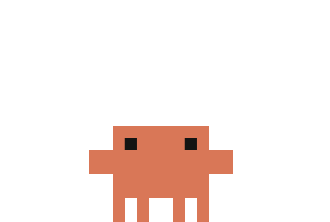

<p align="center">
  
</p>

<h1 align="center">Clawd, on your desktop</h1>

<p align="center">
  A tiny Mac app that lets Clawd wander along the bottom of your screen while you work.
</p>

<p align="center">
  <a href="https://github.com/program247365/clawd/releases/latest"></a>
  <a href="#install"></a>
  <a href="LICENSE"></a>
  <a href="https://github.com/program247365/homebrew-tap"></a>
</p>

<p align="center">
  <b>Clawd is Anthropic's character. This is an unofficial fan project.</b>
</p>

---

Clawd lives in your menubar and walks along the bottom of your screen. Every so often he stops to fish, juggle, water a plant, or put on sunglasses. Clicks pass straight through him, so he never gets in the way.

Watch him do it in a browser at **[clawd.kbr.sh](https://clawd.kbr.sh)**.

## Install

```sh
brew install --cask program247365/tap/clawd
```

Or download [Clawd.dmg](https://github.com/program247365/clawd/releases/latest/download/Clawd.dmg), open it, and drag Clawd to Applications.

Requires macOS 14 or later, on Apple silicon or Intel. The app is signed and notarized. Windows and Linux are planned.

## Quick start

```sh
open -a Clawd
```

He drops in from the top of the screen under a spotlight, lands, gives you a wave, and gets going. His icon appears in the menubar.

## What Clawd does

| | |
| --- | --- |
| **Makes an entrance** | On launch he falls in under a stage spotlight, lands, and waves. |
| **Walks and performs** | He patrols the bottom of the screen, on top of the Dock, and plays each of his 36 acts once before repeating any. |
| **Roams, if you let him** | He stays at the bottom by default. Choose "Let Clawd roam!" in Settings and about one time in four he pops up somewhere else to perform. |
| **Visits your lock screen** | Turn on "Make Clawd visit your lock screen" and he keeps walking while your Mac is locked. |
| **Stays out of the way** | He sits above your windows but never takes a click, a scroll, or focus, and he steps aside for fullscreen apps. |
| **Fits your screen** | Small, Medium, or Large, from the menu. |

From the menubar you can hide him, change his size, turn on Launch at Login, and open Settings (⌘,).

### About the lock screen visit

macOS has no official way for an app to appear on the lock screen. Clawd gets there with private window-server functions, so the option is off by default, and a macOS update could break it. If the functions are missing, the option turns itself off. It is confirmed on macOS 27 and untested on earlier versions.

## Development

The repo holds two apps:

| Path | What |
| --- | --- |
| `apps/clawd` | the Mac app (Swift package) |
| `apps/website` | the clawd.kbr.sh site and the animation files |

Building needs a Swift 6 toolchain (Xcode 16 or newer). From the repository root:

```sh
make check
```

`make check` verifies every act on the site has its animation and thumbnail, builds the app, and runs the tests, including one that renders every animation.

To run a local build of the app:

```sh
make -C apps/clawd run
```

That builds `apps/clawd/dist/Clawd.app` for your Mac with an ad-hoc signature. Other targets regenerate things made from the art: `icons`, `thumbs`, and `readme-gif`.

### Releasing

`make -C apps/clawd release` builds a universal app, signs it with a Developer ID, notarizes it with Apple, and leaves `Clawd.dmg` in `apps/clawd/dist`. It uploads nothing else. It needs notary credentials in a keychain profile, stored once:

```sh
xcrun notarytool store-credentials clawd-notary --apple-id <your Apple ID> --team-id <your team ID>
```

Set `APP_IDENTITY="Developer ID Application: You (TEAMID)"` to sign with your own identity.

## License

MIT for the code — see [LICENSE](LICENSE). © 2026 Kevin B. Ridgway. The Clawd character and the animation files belong to Anthropic and are not covered by the license.
